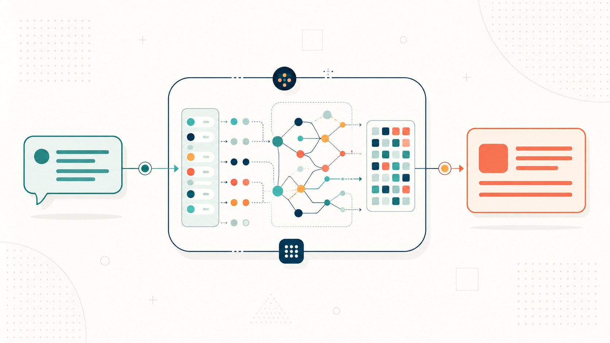

[⬅️ Back to Blogs](../README.md)



# AI Fundamentals - Part 1: From Prompt to Response

AI is becoming a regular part of software development. Whether you're building chatbots, code assistants, search experiences, or internal tools, you'll come across terms like _tokens_, _context window_, _attention_, and _temperature_. While you don't need to understand the underlying mathematics to build AI-powered applications, understanding these fundamentals will help you make better design decisions, debug unexpected behavior, and discuss AI topics with confidence. In this series, we'll build that foundation one concept at a time.

---

## Running Example

Throughout this series, we'll use a single application to explain every concept: an **AI-powered Travel Planner**.

Imagine a user enters the following prompt:

> _I'm visiting Japan for 7 days in October. Create an itinerary with sightseeing, local food, and a day trip to Mount Fuji._

It looks simple, but a surprising amount happens before the model generates the first word of its response. Here is the high-level journey:

```text
User Prompt
      │
      ▼
 Tokenization
      │
      ▼
 Context Window
      │
      ▼
 Transformer
      │
      ▼
   Attention
      │
      ▼
Next-token Prediction
      │
      ▼
 Response
```

Let's start from the very beginning.

---

# What Is an LLM?

An **LLM (Large Language Model)** is a machine learning model trained on enormous amounts of text to recognize patterns in language. Despite the impressive conversations they can have, LLMs aren't databases or search engines-they don't look up answers when you ask a question. Instead, they generate text by predicting what should come next based on everything they've seen so far. That single idea is the foundation for understanding modern AI.

> **Mental Model**
>
> An LLM is a very sophisticated **next-word predictor**. Technically, it predicts the next **token**, not the next word-but we'll get to that shortly.

**💡 Developer's Takeaway**

When your AI application responds, it is dynamically generating new text, not retrieving a predefined answer.

---

# Prompt: Where Every Conversation Begins

Everything starts with a **prompt**, which is simply the input you provide to the model. For our travel planner, the prompt is:

> _I'm visiting Japan for 7 days in October. Create an itinerary with sightseeing, local food, and a day trip to Mount Fuji._

As developers, we usually think of this prompt as a string. However, the model doesn't process strings directly. Before it can do anything, it must first convert the text into something it understands: tokens.

---

# Tokens: The Language an LLM Understands

Humans read words and sentences; LLMs read **tokens**. A token is a small piece of text. Depending on the tokenizer, it could be a complete word, part of a word, punctuation, a number, a symbol, or even a single character.

For example, our prompt might be broken into pieces like this:

```text
I'm | visiting | Japan | for | 7 | days | in | October | ...
```

Or, depending on the model:

```text
I | 'm | visit | ing | Japan | ...
```

The exact split varies between models, but the important takeaway is that **models never see your original sentence; they only see tokens.** This is why API pricing, context limits, and usage are almost always measured in tokens rather than words.

**💡 Developer's Takeaway**

If a provider says a model supports 128K tokens, that does not mean 128,000 words. Because tokens are typically smaller than words (averaging ~4 characters or 0.75 words per token in English), the actual word limit is lower.

---

# Tokenization: Breaking Text into Tokens

The process of converting text into tokens is called **tokenization**. You can think of it as translating human language into the model's native numeric representation.

```text
User Prompt ("I'm visiting Japan...") ──► Tokenizer ──► [5012, 382, 9182, 71, ...]
```

Internally, models work with numbers, not strings. Each token maps to a numeric identifier, which is what the model actually processes. Fortunately, tokenization happens automatically under the hood. As developers, we rarely need to perform it ourselves, but understanding that it exists helps explain many quirks of AI behavior.

**💡 Developer's Takeaway**

Tokenization is one reason two models can behave differently even when given the exact same prompt, as they might break down and interpret the text differently.

---

# Context Window: The Model's Working Memory

Once the prompt is tokenized, those tokens are placed inside the model's **context window**. The context window is the total amount of information the model can consider while generating its response-essentially its active working memory for the current conversation.

For our travel planner, the context window might include:

- The user's current request
- Previous messages in the chat history
- System instructions
- Uploaded documents or external data

Everything inside the context window is available to the model; everything outside it effectively does not exist. This explains why long conversations sometimes cause the AI to forget details you mentioned earlier-those earlier tokens have simply been pushed out of the context window to make room for new ones.

**💡 Developer's Takeaway**

Many "memory" issues are actually context window limitations. Managing context efficiently-pruning old history or summarizing previous turns-is one of the most important aspects of building AI applications.

---

# Transformer Architecture: The Engine Behind Modern LLMs

You've probably heard that modern language models are based on the **Transformer architecture**. At a beginner level, you don't need to understand the mathematics behind it. Instead, remember this: a Transformer is designed to process all tokens in a prompt in parallel, rather than reading them sequentially one-by-one (as older recurrent architectures like RNNs or LSTMs did).

This parallel processing allows the model to analyze the relationships between all parts of the prompt simultaneously and handle significantly larger context windows. It is the primary reason modern AI models are trained on massive datasets and feel dramatically more capable. One of the core mechanisms that enables this is **Attention**.

---

# Attention: Focusing on What Matters

Imagine the model is generating the next part of our itinerary. Which parts of the prompt matter the most?

> _I'm visiting **Japan** for **7 days** in **October**. Create an itinerary with **sightseeing**, **local food**, and a **day trip to Mount Fuji**._

Clearly, tokens like _Japan_, _7 days_, and _Mount Fuji_ are far more important than helper words like _I'm_, _for_, or _in_. The **Attention** mechanism helps the model mathematically calculate which tokens are most relevant to focus on while generating the next token.

It is similar to how a human reads: your eyes naturally focus on the core information rather than reading every word with equal weight. Without attention, generated responses would quickly lose coherence and drift away from the user's instructions.

**💡 Developer's Takeaway**

The clearer, more structured, and more focused your prompt is, the easier it is for the model's attention mechanism to isolate the key instructions and generate a relevant response.

---

# Next-token Prediction: Generating One Token at a Time

Now the model is ready to generate its response. Contrary to how it looks on screen, the model does not generate an entire sentence or paragraph at once; it predicts **one token at a time** in a loop:

```text
Prompt ──► Model predicts: "Day" ──► Context updated ──► Model predicts: "1" ──► ...
```

After generating a token, that token is appended to the context window, and the model runs again to predict the next token based on this updated history. This process repeats hundreds or thousands of times until the model generates a special "stop" token (indicating the end of the text) or reaches a length limit.

**💡 Developer's Takeaway**

Because responses are built incrementally one token at a time, the model is not "planning" the entire paragraph in advance. It only calculates the next most likely token based on what has already been written.

---

# Parameters: What Do 7B and 70B Mean?

If you explore open-weight models, you will see numbers like **7B**, **8B**, or **70B**. The **B** stands for **billion parameters**. Parameters are the internal values (weights) that the model learned and adjusted during its training phase. You can think of them as the neural connections that store the model's knowledge and language patterns.

In general, larger parameter counts mean:

- The model knows more facts and language nuances.
- The model has stronger reasoning capabilities.
- The model requires significantly more memory (VRAM) and compute power to run.

However, parameter count isn't everything. A modern, well-trained 8B model can easily outperform an older, poorly trained 70B model. Model architecture, training data quality, and optimization techniques play a massive role.

**💡 Developer's Takeaway**

Don't choose a model solely based on parameter count. Evaluate smaller models first; they are faster and cheaper, and are often more than capable for specific tasks.

---

# Temperature: Controlling Creativity

Suppose our travel planner receives the exact same prompt twice. Should it generate the exact same itinerary every time? Sometimes yes (for deterministic tasks like coding), and sometimes no (for creative tasks like brainstorming). This variation is controlled by **temperature**.

Temperature changes the probability distribution of the next token:

- **Low temperature (e.g., 0.1 - 0.3):** The model becomes highly predictable, consistently choosing the most probable tokens. This is ideal for structured outputs (like JSON), code generation, and factual QA.
- **High temperature (e.g., 0.7 - 1.0):** The model selects slightly less probable tokens, introducing randomness and variety. This is ideal for brainstorming, storytelling, and creative writing.

**💡 Developer's Takeaway**

Temperature does not make a model smarter or dumber; it simply controls how "adventurous" the token selection is. Always set temperature to 0 or near 0 when you need reliable, repeatable, or structured outputs.

---

# Bringing It All Together

Let's review what happens when our user submits their prompt:

1. **Tokenization:** The text is split into numeric tokens.
2. **Context Window:** The tokens enter the model's active working memory.
3. **Transformer & Attention:** The model processes the tokens in parallel, identifying which parts are most important.
4. **Next-Token Prediction:** The model loops, predicting and appending one token at a time.
5. **Temperature:** The temperature setting influences how predictable or creative each token choice is.

Every modern AI assistant, chatbot, or code tool follows this exact core sequence.

---

# Recap

In this article, we covered the journey from prompt to response, detailing:

- LLMs as next-token predictors.
- Tokenization and the context window.
- The parallel processing of Transformers and the focus of Attention.
- Parameters and Temperature control.

In **Part 2**, we'll explore why models can confidently generate incorrect answers, introducing **pretraining**, **knowledge cutoffs**, **hallucinations**, and how **grounding** and **prompt engineering** help resolve them.

---


